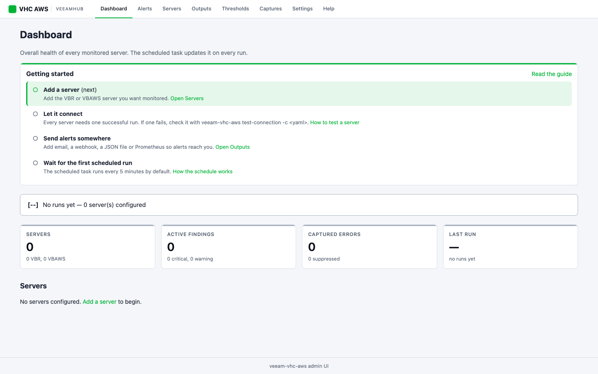
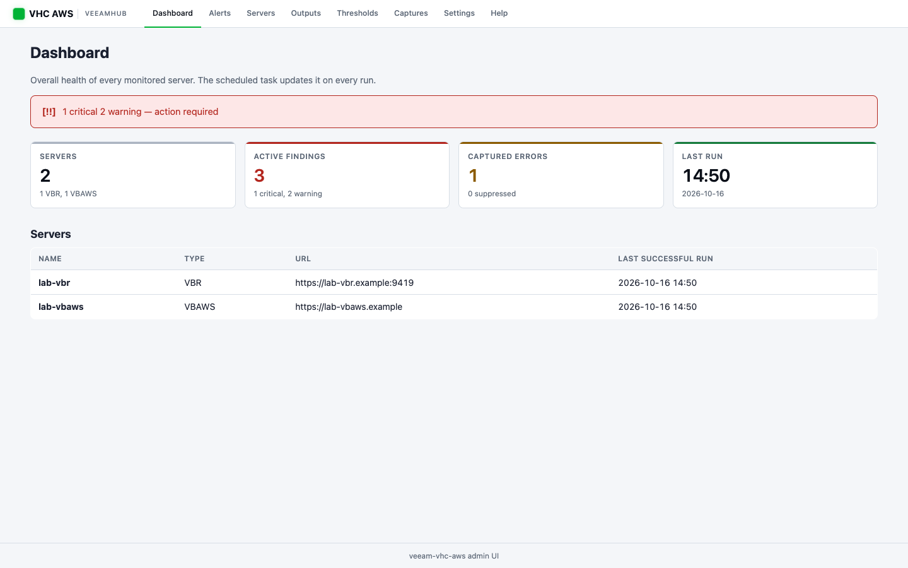
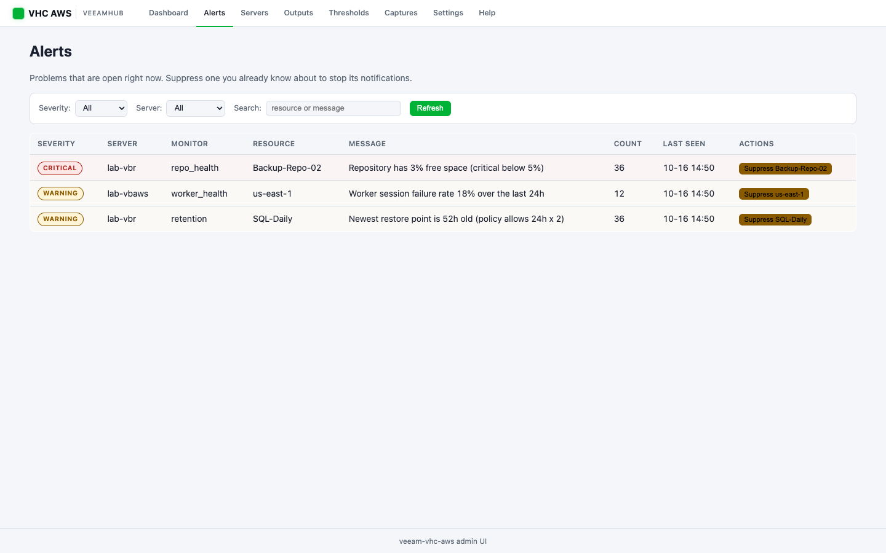
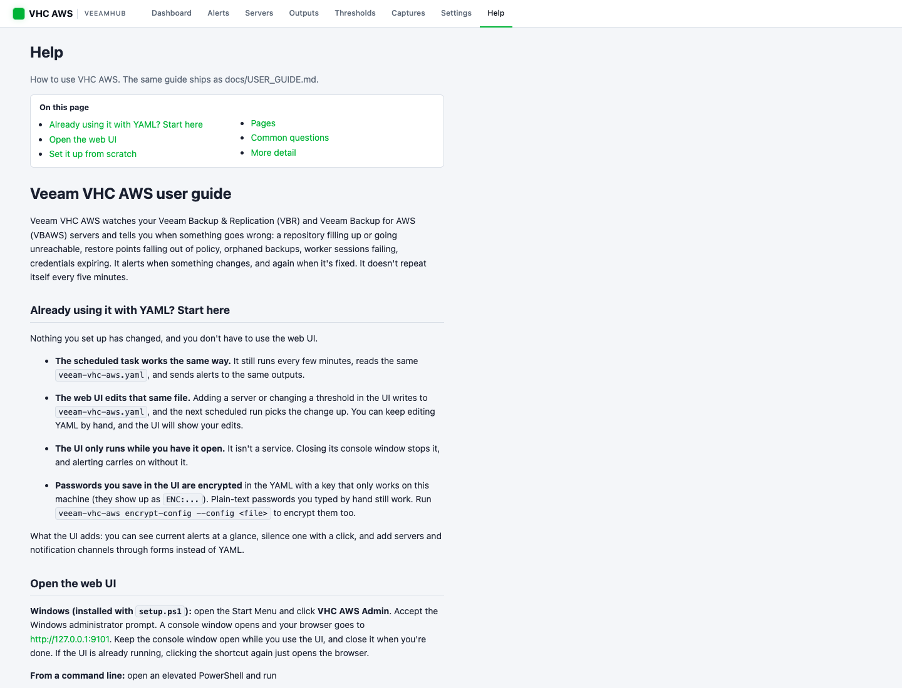

<p align="center">
  
</p>

<h1 align="center">Veeam VHC AWS</h1>

<p align="center">
  <strong>Continuous monitoring and alerting for your Veeam backup infrastructure.</strong>
</p>

<p align="center">
  <a href="https://github.com/VeeamHub/veeam-vhc-aws/actions/workflows/release.yml"></a>
  <a href="https://github.com/VeeamHub/veeam-vhc-aws/releases/latest"></a>
  <a href="LICENSE"></a>
  
</p>

<p align="center">
  <a href="https://github.com/VeeamHub/veeam-vhc-aws/releases/latest"><strong>Download Latest Release</strong></a> &nbsp;&middot;&nbsp;
  <a href="docs/USER_GUIDE.md"><strong>User Guide</strong></a> &nbsp;&middot;&nbsp;
  <a href="https://github.com/VeeamHub/veeam-healthcheck"><strong>Veeam Health Check</strong></a> &nbsp;&middot;&nbsp;
  <a href="https://github.com/VeeamHub/veeam-vhc-aws/issues/new/choose"><strong>Report an Issue</strong></a>
</p>

---

> [!NOTE]
> Veeam VHC AWS is part of the [Veeam Health Check](https://github.com/VeeamHub/veeam-healthcheck) ecosystem — a community-supported suite of tools from [VeeamHub](https://github.com/VeeamHub) for assessing and monitoring Veeam backup infrastructure health. Where Veeam Health Check gives you a point-in-time report, Veeam VHC AWS runs continuously and alerts you the moment something goes wrong. **This is not an officially supported Veeam product.**

## ⚡ Quickstart (60 seconds)

```powershell
# 1. Download the latest release zip, extract it, then in PowerShell 7+ (pwsh) as Admin:
.\setup.ps1

# 2. Open the web admin UI: Start Menu -> "VHC AWS Admin" (accept the admin prompt).
#    A console window opens and your browser goes to http://127.0.0.1:9101
#    -> follow the "Getting started" checklist on the Dashboard
#    -> the Help page in the top bar explains every page

# 3. The scheduled task runs every 5 minutes in the background (-IntervalMinutes changes it).
#    Close the UI's console window when you're done; monitoring keeps running.
```

**Prefer the command line?** From an elevated PowerShell: `& "$env:ProgramFiles\VHC\veeam-vhc-aws.exe" ui -c "$env:ProgramFiles\VHC\veeam-vhc-aws.yaml"`. Without `-c` (or `VEEAM_VHC_AWS_CONFIG`), every command looks for `veeam-vhc-aws.yaml` in the current directory.

**Already using VHC AWS with YAML?** Nothing changes. The scheduled task works as before, and the web UI is optional: it edits the same `veeam-vhc-aws.yaml` and only runs while you have it open. The [User Guide](docs/USER_GUIDE.md) starts with what the UI means for you, and the same guide is on the UI's **Help** page.

**Prefer YAML?** Run `veeam-vhc-aws setup` for the interactive terminal wizard, or edit `C:\Program Files\VHC\veeam-vhc-aws.yaml` directly.

**No web console / headless?** Skip the UI entirely — the scheduled task runs `veeam-vhc-aws all` in the background and sends alerts to your configured outputs (webhook, email, Prometheus, etc.). The web UI is optional and purely an operator console; it has no effect on alerting.

```powershell
# Run all monitors once, send alerts, exit
veeam-vhc-aws all -c "C:\Program Files\VHC\veeam-vhc-aws.yaml"

# Same, but suppress all terminal output (for scripts or CI)
veeam-vhc-aws all -c config.yaml --no-interactive
```

## Features

- **Multi-Server** -- Monitor multiple VBR and VBAWS servers from a single config with dynamic parallelism
- **Repository Health** -- Monitors repo capacity (including SOBR extents), detects unreachable repos, checks all repo-related sessions for credential/S3/connectivity failures. Repo rescan is not implemented.
- **Retention Compliance** -- Validates restore point counts and ages against policy, detects orphaned backups (with Kasten/external policy awareness and configurable exclusions)
- **Worker Health** -- Analyzes VBAWS session failure rates, detects subnet exhaustion, credential failures, and silent retention failures
- **Cross-Correlation** -- Links findings across monitors per-server to surface root causes (e.g., credential expiry causing retention failures)
- **Adaptive Lookback** -- After each successful run, the session lookback window narrows to just since the last success + overlap buffer, dramatically reducing API calls on busy VBR servers. Falls back to full window on failure or first run.
- **Flexible Output** -- JSON, webhooks (Slack/Teams/PagerDuty/ntfy), Prometheus metrics, email
- **Web Admin GUI** -- `veeam-vhc-aws ui` launches a browser-based admin dashboard. View live alerts, suppress with one click, add/edit/delete servers, configure output handlers, and tune thresholds — all without touching YAML
- **Interactive Terminal UX** -- Setup wizard, live monitor progress, severity-coded results table, and actionable connection diagnostics — all auto-disabled for scheduled tasks and scripting
- **Logging** -- Verbose logging with daily rotation and disk space alerts. Webhook and Pushgateway log lines name the host, not the full URL

## 📗 Documentation

### Install

#### Option 1: Windows Standalone (Recommended)

1. Download the **zip bundle** from the [latest release](https://github.com/VeeamHub/veeam-vhc-aws/releases/latest)
2. Extract to a folder (e.g., your Desktop or `C:\VHC`)
3. Open PowerShell 7+ (`pwsh`) **as Administrator** in the extracted folder and run `.\setup.ps1` (Administrator is required to install to Program Files and create a scheduled task; Windows PowerShell 5.1 is refused)
4. The setup wizard will walk you through:
   - Configuring your VBR and/or VBAWS servers
   - Choosing how you want to be notified (ntfy, Slack, Teams, PagerDuty, email, or multiple)
   - Creating a Windows Scheduled Task to run automatically every 5 minutes (`-IntervalMinutes` changes that; `-Upgrade` leaves an existing task interval alone)
   - Adding a **VHC AWS Admin** shortcut to the Start Menu for all users. It opens the web UI elevated, on localhost only. `-DesktopShortcut` also puts one on the Public Desktop; `-NoShortcut` skips both.

That's it. The monitor is now running on a schedule and will alert you when issues are detected.

**Or run setup with parameters for automation:**

```powershell
.\setup.ps1 -AlertUrl "https://ntfy.sh/my-veeam-alerts" -IntervalMinutes 10 -InstallDir "C:\VHC"
```

#### Option 2: From Source (any platform)

```bash
# Requires .NET 10 SDK
dotnet build src/VeeamVhcAws/VeeamVhcAws.csproj
dotnet run --project src/VeeamVhcAws -- setup              # Creates a config file interactively
dotnet run --project src/VeeamVhcAws -- all -c veeam-vhc-aws.yaml   # Run all monitors
```

#### Option 3: Docker

```bash
docker build -t veeam-vhc-aws .
# /path/to/vhc holds veeam-vhc-aws.yaml; the key file, state file and logs are written next to it
docker run --rm -v /path/to/vhc:/config veeam-vhc-aws
```

The image command is `all --config /config/veeam-vhc-aws.yaml`, so the container runs every monitor once and exits with the [exit code](#exit-codes). Run it from cron, a Kubernetes CronJob, or another scheduler. The `VEEAM_VHC_AWS_CONFIG` variable does not override that `--config` argument; to use another path, pass a command, for example `docker run ... veeam-vhc-aws all -c /config/other.yaml`. For a long-running Prometheus exporter, run `serve -c /config/veeam-vhc-aws.yaml --bind 0.0.0.0` and publish the port, because `serve` listens on 127.0.0.1 inside the container by default.

Mount the config **directory**, not only the file. Relative `state_file` and log paths resolve beside the config, and so does the key file.

Passwords are stored as `ENC:` values, sealed with AES-GCM under a random key that is local to the machine, not a passphrase from this repository. The key file is `.veeam-vhc-aws.key` beside the config the command resolved (from `-c`, `VEEAM_VHC_AWS_CONFIG`, or `./veeam-vhc-aws.yaml`), or the path in `VEEAM_VHC_AWS_KEY_FILE`. Anyone who can read the key file can decrypt the passwords, so the key file's permissions are the protection: on Linux and macOS it is created owner-only (mode 600), and on Windows the key is wrapped with DPAPI LocalMachine and the file ACL controls access. An `ENC:` value written on another machine, or with another key file, does not decrypt; re-enter the password or run `encrypt-config` on a plaintext copy. Values written by older releases use a shared passphrase that ships in the source, so they are obfuscation only. They still decrypt, and `encrypt-config` rewraps them with the local key.

> The Docker image is built with the .NET 10 SDK and runs as a self-contained binary on a minimal `runtime-deps` base image.

### Usage

```bash
# Launch the web admin GUI (browser-based)
veeam-vhc-aws ui

# Interactive terminal setup wizard — guides you through server config, notifications, and thresholds
veeam-vhc-aws setup

# Copy the bundled example config (non-interactive / automation)
veeam-vhc-aws setup --template -o config.yaml

# Run all monitors on all servers (live progress + results table in interactive terminals)
veeam-vhc-aws all -c veeam-vhc-aws.yaml

# Run individual monitors
veeam-vhc-aws repo-health -c config.yaml
veeam-vhc-aws retention -c config.yaml
veeam-vhc-aws worker-health -c config.yaml

# Prometheus HTTP server (long-running mode). Listens on 127.0.0.1 unless --bind is set.
veeam-vhc-aws serve -c config.yaml --port 9100 --interval 300
veeam-vhc-aws serve -c config.yaml --bind 10.1.2.3 --port 9100

# Test connectivity to all configured servers (live spinners + actionable error hints)
veeam-vhc-aws test-connection -c config.yaml

# Inspect error patterns or match an error string
veeam-vhc-aws diagnose --list-patterns -c config.yaml
veeam-vhc-aws diagnose --match "Access key has expired" -c config.yaml

# View and manage captured errors and suppressions
veeam-vhc-aws captures list -c config.yaml
veeam-vhc-aws captures suppress <key> -c config.yaml
veeam-vhc-aws captures unsuppress <key> -c config.yaml

# Encrypt plaintext secrets (any key whose name contains password, token or secret,
# the same keys the web UI encrypts) and rewrap legacy ENC: values, with the machine-local key.
# encrypt-config takes --config only; it has no -c alias.
veeam-vhc-aws encrypt-config --config config.yaml

# Print version
veeam-vhc-aws version

# Suppress all interactive output (for use in scripts or CI)
veeam-vhc-aws all -c config.yaml --no-interactive
```

`veeam-vhc-aws serve` listens on 127.0.0.1:9100 and runs every 300 seconds unless you set `--bind`, `--port`, or `--interval`. It runs until stopped and does not set an exit code per cycle. A `prometheus` output with `mode: server` always listens on 127.0.0.1 (its `port`, default 9100); there is no bind option for it.

### Web Admin GUI

The `ui` command launches a browser-based admin dashboard — embedded ASP.NET Core + Blazor Server hosted by the same `veeam-vhc-aws.exe`. No separate install or web server required. On a Windows install, the **VHC AWS Admin** Start Menu shortcut runs it for you. New to the UI? Read the [User Guide](docs/USER_GUIDE.md), which is also the UI's **Help** page.

| First run: the Getting started checklist | Day to day: the Dashboard |
|---|---|
|  |  |
| **Alerts: suppress with one click** | **Help: the user guide, in the app** |
|  |  |

<sub>Screenshots use a demo config with made-up server names.</sub>

```bash
# Localhost-only (default) — admin uses browser on the same machine as the tool
veeam-vhc-aws ui -c config.yaml

# Listen on all interfaces with token auth (for remote admin from your workstation)
veeam-vhc-aws ui -c config.yaml --bind 0.0.0.0 --port 9101

# Regenerate the auth token
veeam-vhc-aws ui --regen-token

# Don't auto-open the browser (useful for headless servers)
veeam-vhc-aws ui -c config.yaml --no-browser
```

If the UI is already running on that port, a second `ui` opens the browser to it and exits instead of failing. If another program holds the port, `ui` says so; pick a different `--port`.

**Pages:**

| Page | What you can do |
|---|---|
| **Dashboard** | At-a-glance status banner, per-server health cards, last-run time, finding counts. A **Getting started** checklist shows until a server is added and connected, an output is configured, and the first scheduled run has landed. |
| **Alerts** | Live table of active findings with severity badges. **Click [Suppress] to silence an alert.** Filter by severity/server, search by resource. Auto-refreshes every 5s. |
| **Servers** | Add/edit/delete VBR and VBAWS servers via forms. Passwords are encrypted on save with a machine-local key and stored with an `ENC:` prefix. Existing values written by the old shared passphrase still decrypt. `encrypt-config` rewrites those legacy values. A server URL change requires the password again. |
| **Outputs** | Add/edit/delete notification channels — webhook (Slack/Teams/ntfy/PagerDuty), email (SMTP), Prometheus, JSON file. Per-type form fields. |
| **Thresholds** | Tabbed editor for per-monitor thresholds (Repo Health / Retention / Worker Health). |
| **Captures** | Historical error log with filter (suppressed/unsuppressed). Same suppress/unsuppress controls as Alerts. |
| **Settings** | Global config: logging level, HTTP timeouts, retry counts, page sizes, daily summary toggle. |
| **Help** | The [User Guide](docs/USER_GUIDE.md), rendered in the app. |

**Authentication:**

- **Localhost (default)** — `--bind 127.0.0.1`. No auth — accessible only from the same machine. RDP in, open browser, manage. Pass `--require-token` to demand the token even on loopback.
- **Remote** — `--bind 0.0.0.0` or specific IP. A 64-char token is auto-generated on first run and stored at `C:\ProgramData\VHC\ui-token.txt` (Windows) or `~/.vhc/ui-token.txt` (others). The file is readable only by its owner (and, on Windows, SYSTEM and Administrators). Token is appended to the URL on startup (`http://server:9101/?t=<token>`) and persisted in a cookie after first visit. The cookie is marked Secure when the request is HTTPS. Rotate with `veeam-vhc-aws ui --regen-token`. Sending the token over plain HTTP puts it in browser history and Referer headers.

**Coexistence with the scheduled task:** The UI is purely an operator console — it reads the state file the scheduled task writes. You can run the UI continuously without affecting the every-5-minutes monitor task. Changes to `config.yaml` made via the UI are picked up by the next scheduled run automatically.

**Live updates:** Alerts page auto-refreshes every 5 seconds; Dashboard every 10 seconds. If the scheduled task writes new findings, you'll see them appear without manual refresh.

### Interactive Terminal UX

When run in an interactive terminal, veeam-vhc-aws renders a rich terminal UI using Spectre.Console. When run as a scheduled task, Windows service, or with output piped/redirected, all rich output is automatically suppressed and the tool behaves as a standard JSON-emitting CLI — no configuration required.

**First-run detection:** If you run `veeam-vhc-aws` with no arguments and no config file exists, the tool offers to launch the setup wizard automatically.

**Setup wizard (`setup`):** A 7-step guided wizard that collects server details, notification channels (Slack, Teams, email, ntfy), output options, and alert thresholds, then writes a config file (default `./veeam-vhc-aws.yaml`, or `-o <path>`). It does not test connections itself; run `test-connection` afterwards. Defaults: `verify_ssl: true`, email `use_tls: true`, free space warning/critical 15%/5%, overage multiplier 1.5, orphan detection on, session lookback 24h. Passwords are encrypted with a machine-local key (`ENC:` prefix). Anyone who can read the key file can decrypt them. Use `--template` to copy the example config instead; without an interactive terminal, `setup` copies the template automatically. Neither overwrites an existing file without asking (`--template` refuses and leaves it alone).

**Live monitor progress (`all`):** While monitors run, a live table shows each server × monitor with a real-time status indicator. Only shown when no `json_stdout` output handler is configured (to avoid mixing UI chrome with JSON output).

```
╭─────────────┬───────────────┬──────────────╮
│ Server      │ Monitor       │ Status       │
├─────────────┼───────────────┼──────────────┤
│ prod-vbr    │ repo_health   │ Done — OK    │
│ prod-vbr    │ retention     │ Running...   │
│ prod-vbaws  │ worker_health │ Queued       │
╰─────────────┴───────────────┴──────────────╯
```

**Results table (`all`):** After monitors complete, findings are displayed grouped by severity (errors → critical → warning), with a one-line status summary above the table.

**Connection test (`test-connection`):** Live progress spinner per target, then a results table. Failed connections include actionable hints (e.g., `— check username/password`, `— set verify_ssl: false or trust the cert`).

**`--no-interactive` flag:** Globally suppresses all interactive output regardless of terminal detection. Equivalent to piping output. Useful for automation scripts that run in a terminal but should not trigger the interactive UI.

### Alert Deduplication

veeam-vhc-aws tracks finding state between runs so you only get notified when something changes — not on every scheduled execution.

| Event | Behavior |
|-------|----------|
| Problem first detected | Alert fires |
| Problem persists on next run | Silent — no repeat alert |
| Problem disappears | `RESOLVED` notification fires |
| Problem comes back later | Treated as new — alert fires again |

State is stored in `veeam-vhc-aws-state.json`. A relative `global.state_file` is resolved from the directory that contains the config file, not from the process working directory. Log files, the state file, and JSON file output paths must stay inside that directory. The program rejects `..` and a symlink that points outside it. If the configured log file cannot be created, logging falls back to the local application data directory. Deleting the state file resets all state. Every existing finding alerts again on the next run.

Deduplication is **on by default** for the alert outputs: `webhook` (every template: generic, slack, teams, pagerduty, ntfy) and `email`. A run where every active finding was already alerted, and nothing resolved, sends nothing. When a run does send, generic, slack, teams, pagerduty, and email include all active findings, while ntfy lists only the new ones. `json_file`, `json_stdout`, and `prometheus` record the full current state on every run and do not deduplicate. To disable it for a specific handler (e.g., to always send every alert regardless of state), add `deduplicate: false`:

```yaml
output:
  - type: webhook
    url: https://ntfy.sh/my-veeam-alerts
    template: ntfy
    min_severity: warning
    deduplicate: false   # send on every run, even if finding already active
```

### Daily Summary

Veeam VHC AWS can send a daily health digest showing the complete status of all monitors — not just new issues. Unlike alert notifications (which only fire when something changes), the daily summary always sends at the configured time.

**Windows Standalone:** During `setup.ps1`, you'll be prompted to enable the daily summary and choose a time (default 8:00 AM local). This creates a second Windows Scheduled Task named **Veeam VHC AWS Daily Summary**.

**Run on demand:**

```powershell
.\veeam-vhc-aws.exe summary -c "$env:ProgramFiles\VHC\veeam-vhc-aws.yaml"
```

**Config options:**

```yaml
daily_summary:
  enabled: true   # set to false to disable
  # output:       # optional: different handlers just for the summary
  #   - type: webhook
  #     url: https://ntfy.sh/my-veeam-daily
  #     template: ntfy
```

The daily summary uses your configured output handlers (same as alerts) but bypasses deduplication — it always sends the full current state.

### Exit Codes

| Code | Severity |
|------|----------|
| 0 | OK |
| 1 | WARNING |
| 2 | CRITICAL |
| 3 | ERROR |

The worst severity across all findings determines the exit code, making it CI/CD-friendly. `all`, `repo-health`, `retention`, `worker-health` and `summary` also exit 3 when startup fails (for example a config that does not parse), and exit 0 when no applicable server is configured (or, for `summary`, when `daily_summary.enabled` is false). `captures suppress` / `unsuppress` exit 1 when the key prefix matches nothing or more than one entry. A suppressed finding (`captures suppress`, the Alerts page, or `suppressions` in the config) does not count toward the exit code or the monitor's overall severity. A monitor that reported errors stays at least WARNING, because errors cannot be suppressed.

### Configuration

Config file resolution order:
1. `-c` / `--config` CLI argument
2. `VEEAM_VHC_AWS_CONFIG` environment variable
3. `./veeam-vhc-aws.yaml` in the current directory

See [`config/example.yaml`](config/example.yaml) for the full configuration reference including server setup, thresholds, output handlers, and error patterns.

#### Performance Tuning

For environments with busy VBR servers or large session volumes, these global settings control API pagination and timeout behavior:

```yaml
global:
  timeout_seconds: 30           # Per-request HTTP timeout (default: 30). Avoid values >60 on slow APIs.
  session_timeout_seconds: 600  # Timeout for /api/v1/sessions calls specifically (default: 600).
                                # Raise to 1200+ for very large deployments (20k+ sessions).
  page_size: 500                # Items per API page (default: 500, was 50 in older versions)
  max_pages: 100                # Circuit breaker: max pages before stopping (default: 100)
```

> [!TIP]
> If your VBR server has a large number of sessions and monitor runs are timing out, increase `session_timeout_seconds` first (e.g. `1200` for 20 minutes). The general `timeout_seconds` applies to all other API calls.

**Adaptive lookback** is enabled automatically. After each successful monitor run, the session lookback window narrows from the configured max (e.g. 24h) down to just the time since the last success + a 2-minute overlap buffer. This means a monitor running every 5 minutes only fetches ~5 minutes of sessions instead of 24 hours, reducing API load by orders of magnitude. The overlap buffer is configurable per monitor:

```yaml
repo_health:
  session_lookback_hours: 24      # Max lookback (used on first run or after failure)
  lookback_overlap_minutes: 2     # Overlap buffer for adaptive window (default: 2)
```

If a run fails (errors fetching data), the lookback window stays wide until the next fully clean run. The max lookback defaults to 24 hours for `retention`, and for `repo_health` to `external_maintenance_lookback_hours` (default 48).

#### Multi-Server

Define all servers in the `servers:` array. Monitors automatically route to applicable server types (repo-health/retention on VBR, worker-health on VBAWS).

```yaml
servers:
  - name: prod-vbr
    type: vbr
    url: https://vbr-prod:9419
    username: DOMAIN\backupadmin
    password: "secret"
    api_version: "1.3-rev1"
    verify_ssl: true   # false only for a lab with a self-signed certificate

  - name: aws-backup
    type: vbaws
    url: https://vbaws-appliance
    username: admin
    password: "secret"
    verify_ssl: true
```

> [!TIP]
> **Passwords and usernames with backslashes** (e.g. `DOMAIN\user`, `P@ss\word`): use **single quotes** in your config file to avoid YAML escape interpretation.
> ```yaml
> username: 'DOMAIN\backupadmin'
> password: 'P@ss\word!'
> ```
> Double-quoted values (`"..."`) process backslash sequences — `\n` becomes a newline, `\t` a tab, etc. Single-quoted values are always literal. If you do use double quotes, escape every backslash: `"DOMAIN\\backupadmin"`.

- **Dynamic parallelism:** 2 or fewer servers run sequentially. 3+ run fully in parallel.
- **Failure isolation:** If one server is unreachable, the others continue normally.
- **Server prefixing:** All findings include the server name (e.g., `[prod-vbr] repo:Backup Copy Repo`).

#### Environment Variable Fallback

For single-server setups, use env vars instead of a config file:

```
VEEAM_VBR_URL, VEEAM_VBR_USERNAME, VEEAM_VBR_PASSWORD, VEEAM_VBR_API_VERSION
VEEAM_VBAWS_URL, VEEAM_VBAWS_USERNAME, VEEAM_VBAWS_PASSWORD
```

#### Notifications

The setup wizard configures notifications for you, but you can also edit the config directly. Stack multiple handlers -- all fire on every monitor run.

| Handler | Template | Use Case |
|---------|----------|----------|
| `json_stdout` | -- | Terminal / piping |
| `json_file` | -- | Log aggregation |
| `webhook` | `ntfy` | Push notifications ([free, self-hostable](https://ntfy.sh)) |
| `webhook` | `slack` | Slack channel alerts |
| `webhook` | `teams` | Microsoft Teams alerts |
| `webhook` | `pagerduty` | PagerDuty incident management |
| `webhook` | `generic` | Custom integrations |
| `prometheus` | `mode: pushgateway` (default) | Push metrics to Pushgateway (`url`) |
| `prometheus` | `mode: server` | Expose `/metrics` on 127.0.0.1:`port` |
| `email` | -- | SMTP email reports |

`webhook` and `email` outputs support `min_severity` to control when they fire (`ok`, `warning`, `critical`, `error`). A webhook defaults to `ok` and email to `critical`.

Webhook and Pushgateway URLs cannot target link-local addresses, `169.254.169.254`, or a loopback host. Set `allow_loopback: true` on that output to allow loopback. Private RFC 1918 addresses stay allowed. Sends do not follow redirects.

Example stacking multiple outputs:

```yaml
output:
  - type: json_stdout
  - type: webhook
    url: https://ntfy.sh/my-veeam-alerts
    template: ntfy
    min_severity: warning
  - type: email
    smtp_host: smtp.office365.com
    smtp_port: 587
    from_addr: veeam-vhc-aws@example.com
    to_addrs: ["oncall@example.com"]
    min_severity: critical
```

### Logging

Log files rotate daily. A relative path stays in the directory that contains the config file. An absolute path is allowed in that directory, and also under `global.data_directory` when that key is set. `setup.ps1` sets `data_directory` to `C:\ProgramData\VHC` and puts the state file and logs under that directory. Key options:

```yaml
global:
  logging:
    level: INFO                     # DEBUG, INFO, WARNING, ERROR (default: DEBUG)
    file: ./veeam-vhc-aws.log       # log file path
    rotation_keep: 30               # number of daily files to retain (default: 30)
    console: true                   # also write to stderr (default: true)
    disk_warning_pct: 20            # warn when drive free space hits this % (default: 20)
```

#### Disk Space Alerts

On every run, veeam-vhc-aws checks the free space on the drive where the log file lives:

| Free Space | Result |
|------------|--------|
| Above threshold | No alert |
| Equal to `disk_warning_pct` | `WARNING` log entry |
| Below `disk_warning_pct` | `ERROR` log entry — fires every run, no deduplication |

The check always fires — it intentionally bypasses the normal finding deduplication so you cannot miss a critical disk condition. Set `disk_warning_pct: 0` to disable.

#### Log Volume Estimates

Logs are small in normal operation. The table below shows estimates for a representative large environment (280 sessions/day, ~4,000 workloads):

| Run Frequency | Log Level | Daily Volume | 30-Day Total |
|---------------|-----------|-------------|--------------|
| Every 15 min  | INFO      | ~1.5 MB     | ~45 MB       |
| Hourly        | INFO      | ~350 KB     | ~10 MB       |
| Hourly        | DEBUG     | ~700 KB     | ~21 MB       |
| Every 15 min  | DEBUG + 30% failure rate | ~13 MB | ~400 MB |

> **Recommendation:** Use `level: INFO` in production. `DEBUG` is useful for troubleshooting but can generate ~400 MB/month on high-failure environments running frequently. If you're on a small Windows VM (< 2 GB free), consider dropping `rotation_keep` to 7–14 days.

### Upgrading

To upgrade without re-running the full setup wizard — your config (`C:\Program Files\VHC\`), state, and logs (`C:\ProgramData\VHC\`) are untouched.

#### Windows Standalone (Recommended)

1. Download the new zip bundle from the [latest release](https://github.com/VeeamHub/veeam-vhc-aws/releases/latest)
2. Extract it
3. Open PowerShell **as Administrator** in the extracted folder and run:

```powershell
.\setup.ps1 -Upgrade
```

That's it. The wizard will:
- Stop the scheduled task, swap in the new executable, and restart it
- Scan your existing config for any keys added since your last install and offer to configure them (e.g., if you're missing `session_timeout_seconds`, it will prompt you)

#### Manual alternative

If you prefer, just copy the new `veeam-vhc-aws.exe` over the existing one:

```powershell
# Stop the scheduled task first to avoid replacing a running binary
Stop-ScheduledTask -TaskName "Veeam VHC AWS"
Copy-Item .\veeam-vhc-aws.exe "$env:ProgramFiles\VHC\veeam-vhc-aws.exe" -Force
Start-ScheduledTask -TaskName "Veeam VHC AWS"
```

> [!NOTE]
> Your config (`C:\Program Files\VHC\veeam-vhc-aws.yaml`), alert state (`C:\ProgramData\VHC\veeam-vhc-aws-state.json`), and logs are stored separately and are never touched by an upgrade.

#### Config changes in recent releases

| Version | New config key | Default | Notes |
|---------|---------------|---------|-------|
| v1.0.0.44+ | `global.session_timeout_seconds` | `600` | Timeout for `/api/v1/sessions` calls. Configurable via the web UI Settings page or YAML. |

#### Behavior changes (unreleased)

- Web UI: a **Help** page renders the [User Guide](docs/USER_GUIDE.md), every page has a one-line description, and the Dashboard shows a **Getting started** checklist until setup is complete. `setup.ps1` adds an all-users **VHC AWS Admin** Start Menu shortcut that opens the UI elevated on localhost (`-DesktopShortcut` adds a Public Desktop icon, `-NoShortcut` skips both, `-Uninstall` removes them). A second `ui` on a port where the UI is already running opens the browser to it and exits 0. No config keys or scheduled-task behavior changed.
- Admin UI auth: loopback binds stay open unless `ui --require-token` is set; any other bind requires the token. Token checks compare hashes, and the auth cookie is marked Secure when the request is HTTPS. Webhook URLs show as `********` in the Outputs page and `/api/config`, and a save keeps the stored URL. Changing a server URL in the UI requires entering the password again.
- Outbound sends: webhook and Pushgateway URLs that target link-local addresses, `169.254.169.254`, or a loopback host are refused unless that output sets `allow_loopback: true`. Redirects are not followed. Webhook log lines name the host instead of the full URL.
- `serve` and a `prometheus` output with `mode: server` listen on 127.0.0.1. `serve --bind <address>` restores a wider listener.
- Paths: relative log, state and `json_file` paths resolve from the config file's directory and must stay inside it (or under `global.data_directory`); `..` and symlinks that escape are rejected. `setup.ps1` writes `data_directory: C:\ProgramData\VHC` and keeps state and logs there. Alert email renders finding text as text, not HTML.
- Deduplication now applies to every webhook template (generic, slack, teams, pagerduty, ntfy) and to email, not only ntfy. A run with nothing new and nothing resolved sends nothing to those outputs; set `deduplicate: false` on a handler to send on every run. Email gained the `deduplicate` key (default `true`) and a checkbox on the Outputs page.
- A suppressed finding no longer raises the exit code or the monitor's overall severity, so it also stops driving `min_severity` checks, PagerDuty severity, and the Prometheus overall-severity value. A run whose only problem is suppressed exits 0.
- `captures suppress` also finds keys that exist only under active findings (the web Alerts page already did). The VBAWS worker-health check now pages through every session in the window (up to 10,000) instead of the first page, so failure rates on busy appliances can move. JSON state and `json_file` output are written to a temp file and renamed into place.
- `encrypt-config` encrypts every key whose name contains `password`, `token` or `secret`, the same keys the web UI encrypts. Before, it only rewrote `password` and `smtp_password`. It now reads the value the way the app does: a single-quoted password is encrypted without its quotes (before, the quotes were encrypted with it, and the decrypted password was wrong), and a line with a trailing `# comment` is encrypted and keeps the comment (before, it was left in plaintext). Current `ENC:` values and all other keys are left byte-for-byte; legacy `ENC:` values are still rewrapped. Webhook URLs are not encrypted, because outputs read them as plain URLs.
- `setup --template` and the README samples write `verify_ssl: true`, matching the web UI, the wizard, and `config/example.yaml`. Set `verify_ssl: false` only for a lab server with a self-signed certificate. `test-connection` suggests it when the certificate is rejected.
- A partial `global:` block (for example only `timeout_seconds`, or `logging:` with only `level`) now keeps the defaults for every key it leaves out. Before, the partial block replaced the defaults, and monitors fell back to a 120-second `session_timeout_seconds` while the Settings page showed 600. The default is now 600 everywhere. An empty `global:` line also keeps the defaults.

---

### Uninstall

#### Windows Standalone

```powershell
# Removes both scheduled tasks, the Start Menu and Desktop shortcuts, the exe and wwwroot,
# then asks whether to delete config, state and logs
.\setup.ps1 -Uninstall
```

Or by hand:

```powershell
Unregister-ScheduledTask -TaskName "Veeam VHC AWS" -Confirm:$false
Unregister-ScheduledTask -TaskName "Veeam VHC AWS Daily Summary" -Confirm:$false -ErrorAction SilentlyContinue
Remove-Item -Force -ErrorAction SilentlyContinue "$env:ProgramData\Microsoft\Windows\Start Menu\Programs\VHC AWS Admin.lnk", "$env:PUBLIC\Desktop\VHC AWS Admin.lnk"
Remove-Item -Recurse -Force "$env:ProgramFiles\VHC"   # install dir: exe, wwwroot, config
Remove-Item -Recurse -Force "$env:ProgramData\VHC"    # state, logs, UI token
```

If you installed to a custom directory, pass `-InstallDir` or replace the path accordingly.

#### From Source

```bash
# Remove config and logs
rm -f ./veeam-vhc-aws.yaml ./veeam-vhc-aws.log ./veeam-vhc-aws-state.json
```

#### Docker

```bash
docker stop veeam-vhc-aws && docker rm veeam-vhc-aws
docker rmi veeam-vhc-aws
```

### Building from Source

```powershell
# Build Windows exe + zip bundle
.\build.ps1

# Or just the exe, no zip
.\build.ps1 -NoZip
```

```bash
# Build for current platform
./build.sh --local

# Build all platforms (win-x64, linux-x64, osx-arm64, osx-x64)
./build.sh
```

### Running Tests

```bash
dotnet test tests/VeeamVhcAws.Tests/     # unit and integration tests
dotnet test tests/VeeamVhcAws.UiTests/   # bUnit tests for the admin UI pages
```

## ✍ Contributions

We welcome contributions from the community! We encourage you to create [issues](https://github.com/VeeamHub/veeam-vhc-aws/issues/new/choose) for Bugs & Feature Requests and submit Pull Requests. For more detailed information, refer to our [Contributing Guide](CONTRIBUTING.md).

## 🤝🏾 License

* [MIT License](LICENSE)

## 🤔 Questions

If you have any questions or something is unclear, please don't hesitate to [create an issue](https://github.com/VeeamHub/veeam-vhc-aws/issues/new/choose) and let us know!
